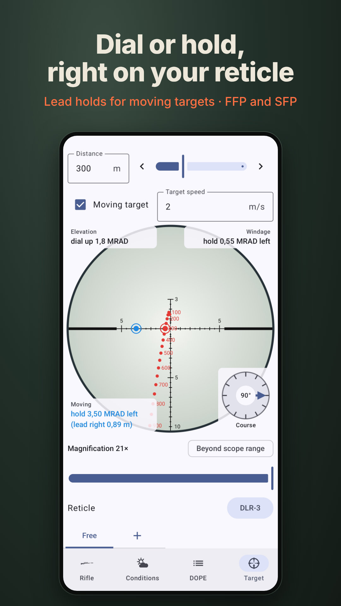
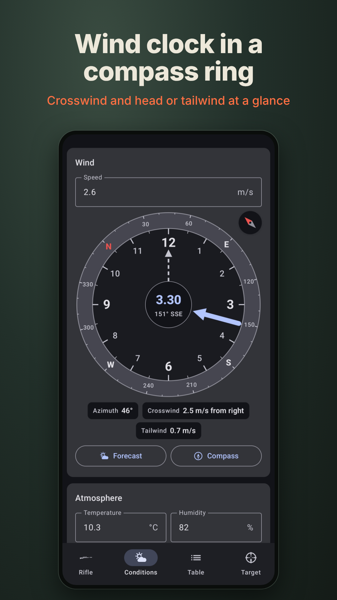
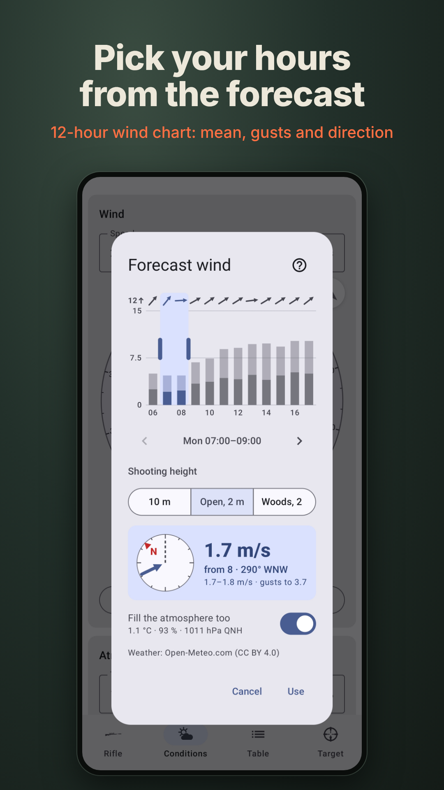
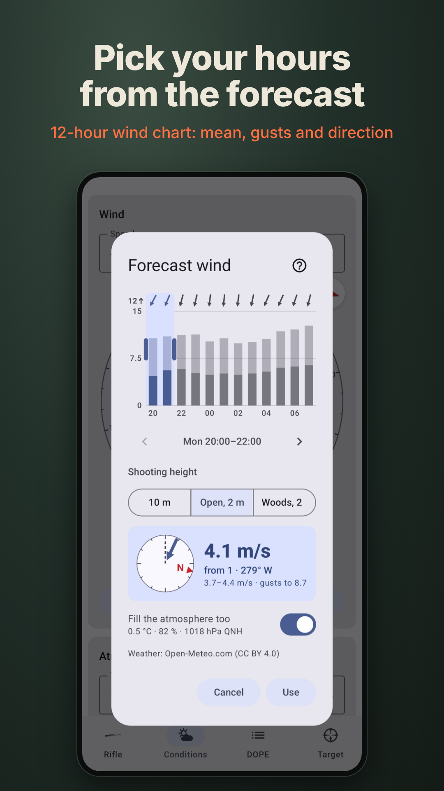
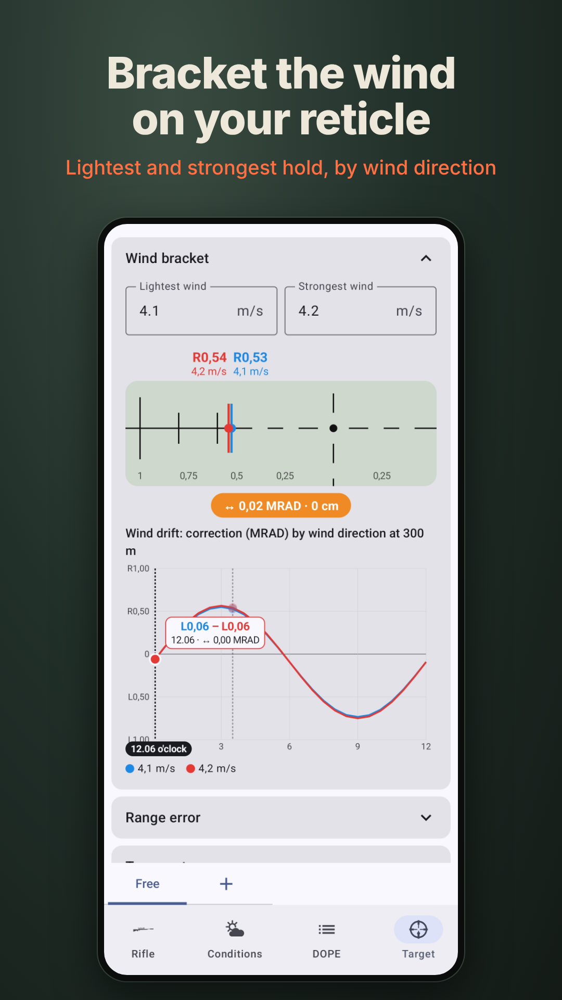
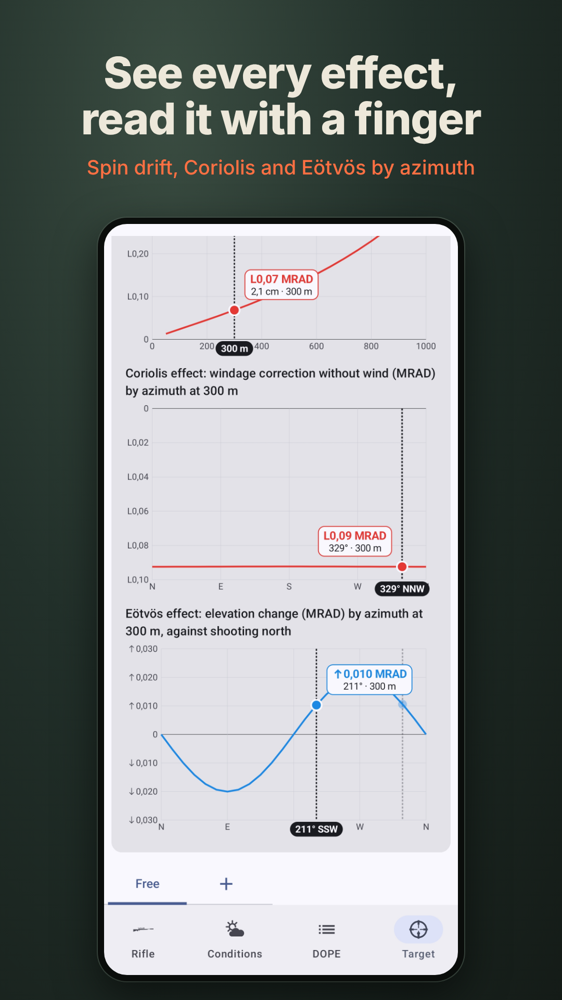
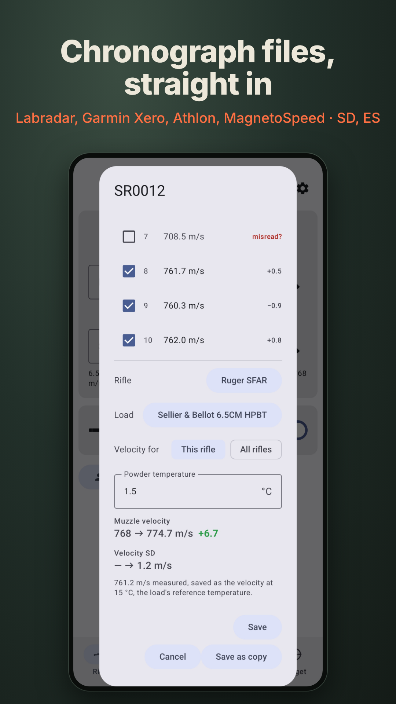
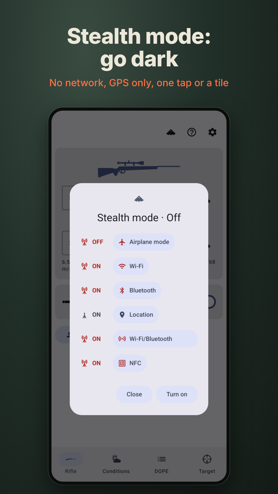

# Ballistics

An Android ballistic calculator by **KGW Labs** (`com.kgwlabs.ballistics`).

Ballistics computes bullet trajectories with a 3DOF point-mass solver built on established, publicly documented
models: standard drag functions, Doppler-derived drag curves, a humid-air atmosphere, Coriolis, spin drift and
aerodynamic jump. It keeps rifle and load profiles, gives a DOPE chart with turret clicks, draws the holds and
the turrets around your scope's reticle, and syncs everything to the cloud.

Current version: **1.2.0**, on [Google Play](https://play.google.com/store/apps/details?id=com.kgwlabs.ballistics)
as "Ballistics by KGW Labs", and as an APK from the [latest release](#installing).

| | | | |
|---|---|---|---|
|  |  |  |  |
|  |  |  |  |

> **Safety note.** A calculator only predicts. Always confirm the dope with live fire before relying on it,
> and check library bullet data against the manufacturer's current figures.

## Features

### Rifle
The first tab: the rifle and load in use, picked from full-width dropdowns under a large rifle and bullet silhouette, with a wrench next to each
to edit it, a one-line summary (caliber, scope, zero, muzzle velocity) and the profile list. Help and
settings sit at its top right, next to the stealth mode aircraft (bare while off, filled while on); there is no title bar, the tabs name the screen. The Chrono button imports chronograph data. When the rifle has a
suppressor configured, a switch says whether it is on; the rifle on the Rifle tab icon then carries a suppressor. Rifles and loads are marked with rifle and bullet icons instead of their names (the pickers on the Rifle tab, the profile list, the editors).

### Profiles
Settings → Profiles (or the Profiles button on the Rifle tab) lists and edits rifles and loads.
- **Rifles**: name, barrel length (inches or cm: tap the unit), scope (turret unit MRAD, MOA or SMOA, click value, turret correction from a tall-target test, reticle and its scale step when the scope's differs
  from the design (e.g. 0.1 MRAD), first or second focal plane,
  calibration and maximum magnification), sight height, zero range and the load it is zeroed with, and the zeroing
  temperature and pressure (station pressure, or QNH with the zeroing altitude).
- **Suppressor**: switched on with the rifle (next to the twist direction); then the zero section asks whether the zero was shot suppressed or bare, and where the impact goes in the other
  state (up and right from the zero, in the turret unit; switching the zero state flips the signs). With the suppressor in the other state than at
  zeroing, every correction (DOPE, target, holds) includes that shift.
- **Sight height helper**: compute it from a caliper measurement, or estimate it from the objective diameter,
  ring height and rail.
- **Loads**: reference muzzle velocity with the barrel length it was measured in, powder temperature sensitivity, bullet weight, diameter, length and twist,
  drag model and BC. Start from the built-in library or enter custom data, including a full Cd(Mach) curve.
- **Velocity per rifle**: each rifle stores the muzzle velocity measured with it for each load, which the
  solver uses instead of the load's reference velocity. The app shows the load's test barrel length and how
  it differs from your barrel; it does not guess a velocity for a different barrel.
- **Calibers**: rifles and loads name their cartridge, picked from a list of common ones or typed. Loads and
  library bullets are grouped by caliber name (".30 / 7.62 mm", "6.5 mm"), and a rifle offers only the loads that fit it (same cartridge, or same bullet diameter
  when a load names none), with a switch to show the rest.
- **Bullet library**: over 600 rifle bullets from Barnes, Berger, Hornady, Lapua, Sierra and Speer with
  published G1 and G7 BCs (Berger with length and twist), searchable by maker, name and caliber, plus common
  factory loads with their test barrel lengths. The bullets come from the open community database
  [ballistics-bullets](https://github.com/krzysztofgw-pl/ballistics-bullets): the app ships a snapshot
  (`tools/update-bullets.sh` refreshes it) and downloads newer versions once a day. Additions and
  corrections go there as pull requests.

Muzzle velocity follows the air temperature (taken as the powder temperature) with the load's sensitivity, or a
standard 0.5 m/s per °C (Prof. Ejsmond) when none is entered; factory velocities are referenced to 21 °C (SAAMI, CIP).

### Conditions
Wind first (it changes most), then temperature, pressure, altitude and humidity, look angle and cant, and the
latitude (while Coriolis is on). Each tab keeps its scroll position. Focusing a number field empties it, with the
old value as a dimmed hint, so typing replaces it; leaving it empty keeps the old value. The keyboard pushes the
content up so the focused field stays visible.

- **Wind dial**: a wind clock (hours.minutes, e.g. 3.30) inside a compass ring. In the shooter view the line
  of fire points up and dragging the ring sets the azimuth; a round map-style button with a red needle
  switches to north up, where the clock turns instead and a tap on the ring points at the target. Under the
  dial: the azimuth, the crosswind (from left or right) and the head or tailwind. A dial takes touches only
  after a tap unlocks it (its rim turns coloured); a tap anywhere else locks it, so scrolling over it changes nothing.
- **Phone compass** for the azimuth, corrected for magnetic declination when the location is known. Each
  reading is checked: the phone's own calibration status and heading accuracy, and the measured field
  against the Earth's field at the location. A warning suggests a figure-eight calibration away from steel.
- **Shot angle from the camera**: aim the crosshair at the target and press the shutter button (the camera starts at 10× zoom, which
  picks the telephoto lens where there is one) and the gravity sensor gives the angle, in portrait or
  landscape. A two-aim calibration (the second with the phone turned over) removes the camera's tilt in
  the body; the sensor's own error, typically 0.5–1°, remains.
- **Latitude** with its hemisphere as the unit (tap °N to switch to °S); the altitude button sets it too.
- **Pressure measurement** (Settings → Data sources: Off, Garmin or Phone, with a Test button): station
  pressure from the phone's own barometer, or from a Garmin watch through a small Connect IQ watch app and
  Garmin Connect ([Station Pressure](https://apps.garmin.com/apps/2ec4993f-ced4-4fde-ad88-8541ef96c7b2) in the Connect IQ Store; see [garmin](garmin/README.md)).
- **Wind from the forecast**: the hourly forecast for the phone's location
  ([Open-Meteo](https://open-meteo.com), free for non-commercial use) as a 12-hour chart of mean wind, gusts
  and direction arrows (as a clock or true bearings, set in Settings). Drag the window over the hours you will
  shoot: mean speed, vector-mean direction, gusts and a warning when the direction is unsteady. The 10 m
  forecast can be scaled to the shooting height (10 m, open ground or woods at ~2 m), and the direction is
  converted to the line of fire with the shot azimuth. Temperature, humidity and pressure can be filled in
  from the same forecast; the direction swing of the chosen hours feeds the wind bracket chart.
- **Altitude** (Settings → Data sources): the button under the field reads the terrain map (GUGiK's 1 m lidar
  model in Poland, a 90 m model via Open-Meteo elsewhere) or GPS, converted to height above sea level, and
  sets the latitude from the same fix (untick "Latitude from location" to keep it). The field can always be
  typed in. The pressure and altitude buttons sit side by side under their fields.

### Chronograph import
The Chrono button on the Rifle tab opens a chronograph file, or the file can be shared or opened into the app
from another app: Labradar and Labradar LX series reports, Garmin Xero C1 (ShotView CSV or FIT), Athlon
Rangecraft (Excel), MagnetoSpeed V3 and Sporter, or any table with a velocity column. Velocities can also be
typed shot by shot in m/s or fps. It shows the average, SD and ES, flags shots that look misread, lets each
shot be ticked in or out, and saves the velocity for this rifle or for the load (all rifles), corrected to the
load's reference powder temperature. Replacing a saved value asks first: Replace or Save as copy.

### DOPE
For each range: drop, elevation and clicks, wind drift and windage correction, velocity, energy, time of
flight and Mach. The cm columns say where the bullet goes (drop below the line of sight, drift with the
wind); the MRAD or MOA and clicks columns are the correction, with no mark for up, ↓ for down and R or L for
windage. The range column stays in place while the other columns scroll sideways; the details at the top fold
with an arrow or a tap on the open tab. The DOPE range and step are set below it.

### Target
Pick a distance to the metre with the slider, the arrows or by typing it (all in one row), and get the
hold and the dial correction for it. Per reticle design (MRAD and MOA versions together), Settings chooses whether elevation and windage are dialed
or held. Dial corrections are whole clicks and holds are to 0.05; the reticle shows the holds left after dialing for the chosen distance,
with one line of hold advice per axis under it.
- Turrets: the elevation turret above the reticle and the windage turret to its right show what to dial, in
  the scope's unit with its turret correction. Drag a turret to turn it by whole clicks (it stays turned at
  every distance and the holds follow); the round button in the corner resets both to the computed values.
  With windage dialed, orange marks show the forecast's lightest and strongest wind beside the aim point.
- Wind flag: a green flag in the upper left of the lens leans with the wind's strength (Beaufort), with the
  speed and the expected range beside it and a small top-down dial for its direction.
- Moving target, switched on with the running figure in the distance row: its speed in the field beside the
  distance and its course on a small see-through dial in the lens (up = away, right = to the right). The lead
  uses the time of flight to where the target will be; its hold point is drawn on the reticle in blue, with
  the hold on a plate beside it.
- A compass above the lens shows the shot azimuth.
- Impact points drawn on the scope's reticle, with a magnification slider; the same holds can be
  previewed on any other reticle.
- Charts at that distance: wind drift correction by wind speed (one line per wind direction) and by wind
  direction (one line per wind speed), each solved with the full model, so spin drift and aerodynamic
  jump are included, with a callout for every series at the current wind.
- Spin drift (gyroscopic drift) by distance, and the Coriolis effect (windage) and Eötvös effect
  (elevation) by azimuth.
- Reading the charts: a finger moves a point and its callout along the curve, and the x value shows on a chip
  under the line; the reading stays when the finger lifts, a tap clears it, and on the charts by distance a
  finger held still picks that distance. Each chart has its own switch in Settings → Display → Charts, and
  charts are worked out only for open cards.
- Range card: targets saved as sub-tabs (distance, look angle, azimuth, motion and size). Changes made
  while a target is open are saved to it.
- Wind bracket: holds for the lightest and the strongest expected wind, drawn on a zoomed slice of the
  reticle with the spread between them, and a chart of both by wind direction with the forecast's direction
  swing as a band; the forecast fills both speeds in, and its gusts raise the strongest.
- Range error: where the shot lands (rows like "−50 m ↑ 22 cm") when the distance is off by up to ±50 m,
  a chart of it, and the error that still hits a target of the given height.
- Temperature: muzzle velocity and elevation 10 °C colder and warmer.
- Hit probability: chance of a first-round hit on the target (its width and height are set here) from the velocity SD (load), the 5-shot
  group (rifle) and how well the wind and the distance are known. Each source's spread comes from the
  full solution; a 5-shot group is taken as three standard deviations. A chart shows it by distance.
- Ranging with the reticle: distance from the target size and its reading in the reticle.
- BC from range data: the BC that matches a measured drop or downrange velocity, saved to the load or as a copy.

### Stealth mode
The aircraft icon on the Rifle tab, Settings → Stealth mode or a Quick Settings tile (Settings can add it;
a long press on it opens the stealth window) stops every connection the app makes: forecast, terrain height,
Firestore sync, bullet database, update and store checks, and the Garmin watch link unless allowed. Location
comes from GPS alone, without network assistance (it can be turned off too). Android lets no app switch the
phone's radios, so a bar over every tab turns red while they still transmit, and the stealth window lists
airplane mode, Wi-Fi, Bluetooth, location, scanning and NFC/UWB with shortcuts to each. The setting stays on
the phone and is never synced.

### Help
The question mark on the Rifle tab, next to the gear: short answers on getting started, the zero, QNH or station pressure,
muzzle velocity, the suppressor, turret units and correction, wind, the forecast, altitude, the Garmin watch, shot angle, chronograph import, the Target
screen, moving targets, the Target tools, charts, the DOPE, sync, stealth mode, updates (GitHub build only) and accuracy.

### Settings
The gear on the Rifle tab, in this order:
- **Profiles**: rifles and loads.
- **Ballistic model**: spin drift, aerodynamic jump and Coriolis on or off.
- **Data sources**, in the order of the Conditions tab: QNH (default) or station pressure; pressure
  measurement (Off, Garmin or Phone) with a Test button; altitude from the terrain map or GPS; whether the
  location also sets the latitude; forecast direction as a clock or true bearings.
- **Stealth mode**, with its main switch in the header: GPS and the watch allowed or not, the bar, the tile.
- **Display**: light, dark or system theme; keep the screen on; tabs and sub-tabs at the top or the bottom;
  charts (one switch, and an arrow that opens the per-chart list).
- **Corrections**: dial or hold for elevation and windage, per reticle, with the reticles of your scopes first.
- **Sync** and backup, and **About**.

### Sync and backup
- Google sign-in (the icon-only Sign in with Google button, the Google "G") with live sync through Cloud Firestore (newer change wins). Signed in, Settings shows a cloud icon (red on a sync error) and the same G button, which asks "Sign out <email>?".
- JSON export and import of all profiles.
- Android Auto Backup.

## Physics

- **3DOF point-mass model** integrated with 4th-order Runge–Kutta (0.5 ms step) in an Earth-fixed frame,
  the model class used by JBM and most modern ballistic calculators.
- **Drag functions** G1, G2, G5, G6, G7, G8, GI, GS and RA4 (BRL data) with monotone cubic (PCHIP)
  interpolation.
- **Velocity-banded BCs** (Sierra style) and **custom Cd(Mach) curves** from Doppler radar (Lapua, Hornady),
  the most accurate option available.
- **Atmosphere**: humid-air density (Buck vapour pressure), speed of sound from virtual temperature,
  ICAO lapse rate along the flight path, station pressure or QNH, density altitude.
- **Wind**: the solver supports 3D wind (including vertical) by range zones; the app currently uses a single
  horizontal wind.
- **Coriolis and Eötvös**: the full −2Ω×v acceleration, with WGS-84 normal gravity by latitude and height.
- **Gyroscopic stability**: Miller formula corrected for velocity and air density.
- **Spin drift** and **aerodynamic jump** from crosswind (Litz).
- **Inclined fire and cant**, **powder temperature sensitivity**, separate zeroing conditions.

### Verification
`ReferenceTrajectoryTest` compares results with the independent
[py-ballisticcalc](https://github.com/o-murphy/py_ballisticcalc) implementation for G1 and G7 with wind out to
1000 m (0.1 MOA tolerance). `PhysicsTest` checks the ICAO atmosphere, the directions of Coriolis, Eötvös,
spin drift and aerodynamic jump, and a hand-computed stability factor. `ScopeMountTest` covers the
sight height helper.

## Installing

The Play build (flavor `play`) comes from [Google Play](https://play.google.com/store/apps/details?id=com.kgwlabs.ballistics) and updates through the store.

Every build of `main` is published as the latest release with the signed APK attached. The newest APK
is always at <https://github.com/krzysztofgw-pl/ballistics-calculator/releases/latest/download/ballistics.apk>:
open it in the phone's browser (a home-screen shortcut makes it one tap) and install it, allowing installs
from unknown sources when asked.

After that the APK build (flavor `github`) updates itself: **Settings → About → Check for update** looks at the latest release and
offers to install a newer build, and **Check for update on start** (off by default) does the same at launch. Android asks once to allow installs
from the app.

Pull request builds are not released; their APK is the `ballistics-apk` artifact of the run in the **Actions** tab.

Requires Android 8.0 (API 26) or newer. Builds signed with the release key update each other in place.
Coming from a build signed with a different key or an older package name, export your profiles first,
uninstall the old app, then import them.

### Web app (iPhone and other phones)

Every build of `main` also publishes a web version to <https://krzysztofgw-pl.github.io/ballistics-calculator/>.
It runs the same solver, compiled to JavaScript, and covers profiles, conditions, the DOPE and the target
screen, with the shot angle measured through the camera. On an iPhone open the link in Safari and tap
**Share → Add to Home Screen**: it then opens full screen like an app and works offline. Profiles are kept
in the browser; **Settings → Export / Import** uses the same file as the Android app, so profiles move
between the two. Garmin pressure, the forecast, reticles and cloud sync are Android only for now.

GitHub Pages has to be enabled once: repository **Settings → Pages → Source: GitHub Actions**.

## Project layout

| Path | Contents |
|---|---|
| `core/` | Ballistic solver in Kotlin Multiplatform (JVM for Android, JS for the web), and its tests |
| `app/` | Android app in Jetpack Compose (Material 3) |
| `app/.../data/` | Profiles, bullet library, local storage, Firebase sync |
| `app/.../reticle/` | Reticle definitions |
| `app/.../ui/` | Screens: Rifle, Profiles, Conditions, DOPE, Target, editors, chronograph, stealth |
| `fastlane/metadata/android/` | Google Play listing texts and screenshots (framed with `tools/store-screenshots/frame.js`) |
| `web/` | Web app (PWA): Kotlin/JS on the DOM, manifest and service worker in `src/jsMain/resources` |
| `.github/workflows/build.yml` | CI: solver tests, signed release APK, web app on GitHub Pages |

All UI text lives in `app/src/main/res/values/strings.xml`; translations are added as `values-xx` folders.
The web app keeps its text in `web/src/jsMain/kotlin/pl/ballistics/web/Strings.kt`.

## Building

Requires JDK 17.

```bash
./gradlew :core:allTests             # solver tests on the JVM and Node.js, no Android SDK needed
./gradlew :app:assembleGithubRelease # APK with the in-app updater, needs the Android SDK
./gradlew :app:bundlePlayRelease     # Google Play bundle (no updater)
./gradlew :web:jsBrowserDistribution # web app in web/build/dist/js/productionExecutable
./gradlew :web:jsBrowserDevelopmentRun --continuous # web app at http://localhost:8080 with reload
```

The `app` module is included only when an Android SDK is configured (`local.properties` or `ANDROID_HOME`),
so the solver can be built and tested anywhere.

### Release signing

CI signs the APK with the key from the `SIGNING_KEYSTORE_BASE64` and `SIGNING_PASSWORD` repository secrets
(alias `kgwlabs-ballistics`). Without them it falls back to the debug key, and such APKs cannot update an
installed release build. Keep the keystore safe: without it you cannot ship updates.

### Firebase

Cloud sync is enabled when `app/google-services.json` is present; without it the app works offline only.
The Firebase project needs Google sign-in enabled, the release SHA-1 and SHA-256 fingerprints registered for
the Android app, and these Firestore rules, which let each user read and write only their own document:

```
rules_version = '2';
service cloud.firestore {
  match /databases/{database}/documents {
    match /users/{uid} {
      allow read, write: if request.auth != null && request.auth.uid == uid;
    }
  }
}
```
